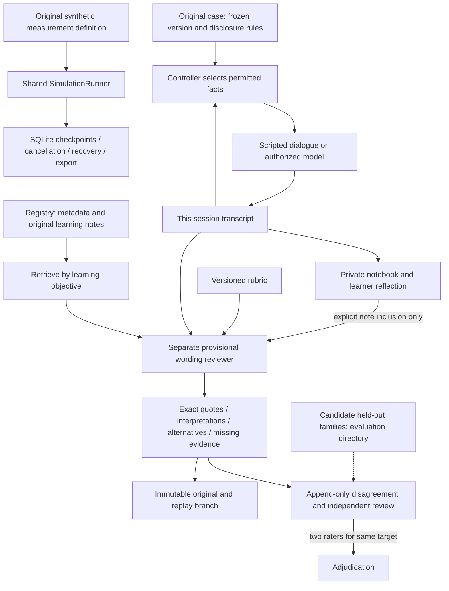

# Architecture and procedure contract

## Evidence-informed practice extension

The implemented extension adds an objective-keyed reference registry, three original versioned cases, pre-feedback reflection, append-only correction/independent-review records, and a synthetic measurement lab. See [data-use decisions](EVIDENCE_AND_DATA_USE.md), [measurement model](MEASUREMENT_LAB.md), [case schema](original-case.schema.json) and [review workflow](../evaluation/README.md).

`cases.py` validates original case files; no evaluator or reference library enters `practice_client.client_context`. The controller filters later disclosures using versioned topic patterns across the current transcript. Initial facts, strengths and goals are allowed; unrestricted background and all future disclosures are withheld. The model can still invent facts, so this boundary is not a guarantee of consistent output. The offline path is the deterministic baseline.

`knowledge.py` serves short original, unreviewed learning notes with citations, including an insufficient-evidence result for unknown objectives. `practice_review.py` stores immutable corrections and independent ratings in an additive SQLite table; reviewer identities are locally declared, not authenticated. Candidate held-outs are excluded from runtime imports. Measurement and conversation diagnostics use `SimulationRunner.launch_exercise` and the same worker/cancel/checkpoint infrastructure as conformity Monte Carlo. Exercise records remain separate in list endpoints, share JSON export, and retain their full versioned definitions. No new runtime dependency or fine-tuning was added.

The case library supports English adult fiction only. Role, mode and local setting are recorded without asserting uniform professional scope. No imported dataset, human-validity result, or professional endorsement is claimed.

The default experience is now practitioner–client rehearsal. See [practice architecture](PRACTICE.md) for its controller, isolated client, rule-based reviewer, recorder, versioned scenario and immutable replay relationships. The sections below document the retained **experimental** procedure; their participant and scoring claims apply to research runs, not client conversations. The separate implemented Monte Carlo workspace uses `simulation.py` and probability-generated participants, never a model-generated human population.

## Responsibilities

React/TypeScript/Vite provides authoring, preview, run controls, comparison and inspection. FastAPI validates requests and owns participant rendering, execution, deterministic scoring, exports, and local SQLite records. PydanticAI invokes one isolated participant with explicitly supplied history. Credentials and provider selection stay on the server.

| Module | Responsibility |
| --- | --- |
| `protocol.py` | Strict study/settings models, neutral-token schema, rendering, seeded pairing, descriptive metrics |
| `participant.py` | FunctionModel fixtures or explicit OpenAI adapter, structured response, boundary/wire capture |
| `runner.py` | Allocation, dispatch, stopping, bounded retries, cancellation, deterministic scoring and checkpoints |
| `simulation.py` | Independent NumPy probability model, bounded settings, scoring, background execution, cancellation and Monte Carlo aggregation |
| `store.py` | Immutable study revisions, frozen configuration, terminal-record protection, append-only events and recovery |
| `exports.py` | Full-identity CSV records with safe spreadsheet escaping and preserved missing outcomes |
| `api.py` | Local API, single-controller database lease, production static files |

The experimental controller, scorer and recorder are ordinary software. The peers are fixed statements. No model judge, shared participant memory, agent handoff or autonomous controller is installed. Practitioner practice adds a separate rule-based educational reviewer.

## Experiment

Each pair has two session IDs, one per condition. Both use the same protocol, option mapping, provider/model configuration and fixture profile. A SHA-256 function of allocation seed and pair index determines within-pair order; the algorithm version and actual schedule are retained. Each session executes its initial and revised answers sequentially, then the controller advances to the next session. There is no shared initial response and no cross-session memory.

The initial JSON stimulus contains instructions, the question and options with tokens A–H. The response schema contains only the available tokens. Semantic choice IDs and the answer key remain in the researcher record. The second invocation contains the session's initial messages, answer and framework output-tool acknowledgement, followed by the peer statements plus the neutral re-ask, or the re-ask alone. No correctness feedback is shown.

Preview calls the same `initial`, `revision`, and response-type constructors used by execution. Its selected example answer is illustrative. Actual model-boundary messages and provider wire bodies are captured during execution. PydanticAI may attach internal trace identifiers after the original response capture; original raw responses are preserved.

Researcher title, research question, hypothesis, notes, allocation labels and option IDs are excluded by explicit field selection. The user controls participant wording: a cue typed into instructions or a peer statement is visible. Withholding metadata does not establish that a model cannot recognize a known procedure.

## Lifecycle and storage

The SQLite schema version is 1. Unknown versions are refused. Studies are append-only revisions with canonical SHA-256 content hashes. Runs are durable JSON documents updated inside SQLite transactions; SQLite WAL and full synchronous mode provide durability. Every checkpoint validates frozen fields, append-only lifecycle events and finalized attempts before writing. Terminal records cannot be modified through the store.

At launch, the protocol revision, settings, mapping, schedule and provenance freeze. Before each invocation, the planned prompt and unique run/pair/session/stage/attempt IDs are persisted. The model wrapper captures exact messages, settings and output-tool definitions before dispatch, then the raw response before Pydantic validation. Provider hooks separately capture JSON wire bodies without headers or error bodies. Parsing/scoring follows capture.

Attempt purposes distinguish `independent_answer`, `scheduled_revision`, and `transport_retry`. Format repair and persona regeneration are disabled and declared in provenance. Only explicit transport retry configuration permits a second attempt for a connection failure, HTTP 429 or server error. It does not add failed attempts to participant history. Local or provider timeouts are never retried. The SDK retry setting is zero and the agent request budget is one per recorded attempt.

Failure of an initial attempt leaves both answer outcomes missing and skips revision. Failure of a revision preserves the valid initial answer. User cancellation retains the in-flight record and stops remaining dispatches. Process interruption leaves durable state for recovery. Startup converts unfinished attempts/sessions/runs to interrupted and preserves all completed data. It never resumes generation. A received-but-not-validated response may remain in an interrupted attempt; it is not silently promoted to a valid answer.

## API and contracts

`GET /api/example` and `/api/settings` expose defaults. `POST /api/preview` inspects an unsaved protocol. `GET/POST /api/studies` and `GET/PUT /api/studies/{id}` list/create/read/revise studies; `?revision=N` selects history. `POST /api/runs` freezes and starts a saved revision. `GET /api/runs` lists summaries and `GET /api/runs/{id}` retrieves the full record. `POST /api/runs/{id}/cancel` cancels. `GET /api/runs/{id}/export/{json|sessions.csv|attempts.csv}` exports.

Invalid input returns 422, absent records 404, concurrent launches 409, and non-local browser mutations 403. Mutations require JSON. A local OS file lock prevents simultaneous controllers against one database, including concurrent startup recovery. The service binds to loopback; this is not a hosted authentication design.

OpenAPI is retained in `docs/openapi.json`; generated frontend types are in `frontend/src/schema.ts`. Input types are generated from Pydantic; additional persisted-record display types are in `frontend/src/types.ts`. API integration and browser tests exercise their shared record structure.

## Probability-based Study rehearsal

An additive `simulations` table stores Monte Carlo records alongside the existing invocation `runs`, under the same database lease and schema version. `SimulationRunner` dispatches CPU work and checkpoints to a worker thread; it never invokes the participant adapter. The controllers exclude simultaneous launches. Frozen protocol/configuration fields, append-only repetition records, terminal protection and startup recovery follow the same storage conventions as invocation runs. The full model, independent-stream strategy, denominators, API routes and limitations are documented in [STUDY_REHEARSAL.md](STUDY_REHEARSAL.md).

`StudyRehearsal.tsx`, `SimulationDiagram.tsx`, `SimulationCharts.tsx` and `simulation-types.ts` keep this mode separate from the existing UI workflows. Saved records list both types without treating Monte Carlo repetitions as model attempts. Charts and diagram use native SVG/HTML rather than an added visualization library.

## Interpretation and export

Answer-change denominators include only sessions with two valid answers. Missing/failed outcomes are reported separately. Initial and revised accuracy each use their own valid-answer denominator. Correct-to-incorrect and incorrect-to-correct transitions use complete sessions with the corresponding initial correctness. They are descriptive procedure counts, not inferred human effect sizes.

JSON retains nulls and nested request/response records. CSV uses stable identifiers, quotes multiline cells, preserves missing values as blanks, and prefixes formula-like text with an apostrophe. Structured cells contain serialized JSON. Fixtures and model outputs have explicit distinct provenance. Reading a record does not create a new execution.
