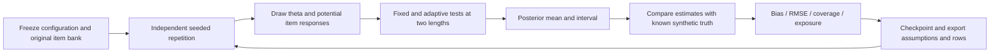

# Synthetic measurement rehearsal

Implemented: `measurement.py` runs through the existing `SimulationRunner`, SQLite `simulations` table, checkpoint/cancel/recovery code and JSON export. No catsim or other dependency was added. Existing conformity rehearsal remains separate in the UI and list endpoint.

The original bank has 41 binary item difficulties evenly spaced on [-3,3], discrimination 1, guessing 0. Each repetition draws theta from the selected normal distribution and 41 uniform potential responses using NumPy PCG64 with `SeedSequence(seed, spawn_key=(700, zero_based_repetition))`. Four designs share that theta and the uniform assigned to each item: short/long tests × fixed-spread/adaptive selection. Repetitions are independent. Sharing potential responses makes comparisons paired; it is not a model of people retaking tests.

Response probability is `(1-lapse) * logistic(theta-b) + lapse * 0.5`. The response-mixture control represents an explicit synthetic mismatch, not a clinical response-validity indicator. The estimator assumes no mixture and uses a standard-normal prior on 201 equally spaced nodes [-5,5]. Log likelihoods accumulate without underflow; normalized posterior weights give the EAP estimate. The 2.5% and 97.5% cumulative grid nodes define a central 95% credible interval. Grid truncation matters for extreme abilities. No item calibration error is modeled.

Fixed tests use rounded equally spaced indices over the entire bank. Adaptive tests pick the unused item whose difficulty is closest to the current EAP; lower index wins ties. For a 1PL item this maximizes information at the point estimate. There is no content balancing, exposure constraint or stop rule beyond test length. Every selected item, binary response and estimate path is exported.

Bias is mean estimate-minus-truth; RMSE is the square root of mean squared error. Coverage is the fraction of generated theta values inside intervals, with Monte Carlo SE `sqrt(p*(1-p)/N)`. It is empirical coverage under this simulator, not a real-person confidence guarantee. Exposure is the fraction of repetitions selecting an item; exposure sums to test length. `distribution()` from the conformity implementation supplies descriptive error quantiles and SD. The record preserves seed, parameters, bank, algorithms, package versions, completed repetitions and failures. Maximum 1,000 repetitions and 30 items per design bound work; cancellation retains the completed in-flight repetition.

The interface connects to the fictional score-report encounter, but does not present simulation output as that person's test result. Questions prompt learners to consider assessment selection, response conditions, norms, language and missing evidence. Recovery under known parameters does not establish reliability of a real test, construct validity, fairness, diagnosis or clinical utility. No real human data, norms or proprietary test items are supplied.

API: `GET /api/measurement/definition`, `POST /api/measurement/runs` with `MeasurementConfig`, `GET /api/measurement/runs`; common `/api/simulations/{id}` polling, `/cancel` and `/export/json`. CSV is deliberately unavailable for these nested exercise records. Conformity CSV exports remain supported.
